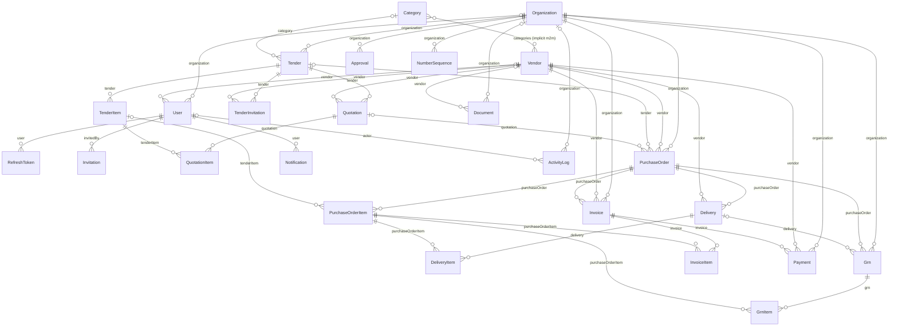
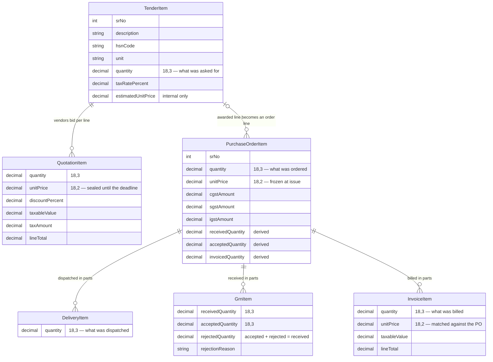

# TenderBridge — ER diagrams

Two views, both generated from `server/prisma/schema/*.prisma`:

| File | What it shows | Use it for |
|---|---|---|
| `er-diagram.mmd` | all 25 entities, 44 foreign keys | the full schema figure |
| `er-chain.mmd` | the six-hop item chain with its key columns | the figure people can actually read |

A `.mmd` file holds exactly one diagram — paste one file at a time into <https://mermaid.live> and
export the PNG (`er-diagram.png`, `er-chain.png`).

Generated from `server/prisma/schema/*.prisma`. Mermaid renders inline on GitHub and in VS Code;
export a PNG for the report with the Mermaid Live Editor (<https://mermaid.live>) or the
Markdown Preview Mermaid extension, and save it next to this file as `er-diagram.png`.

The six-hop item chain is the spine to trace: **TenderItem → QuotationItem → PurchaseOrderItem →
DeliveryItem → GrnItem → InvoiceItem**.

## The item chain

The traceability story in one picture: given any invoice line you can walk back to the tender line
that started it. Note the three derived running totals on `PurchaseOrderItem` — they are what the
three-way match and the fulfilment state are computed from, and no user ever writes them.

## Reading it

| Notation | Meaning |
|---|---|
| `A ||--o{ B` | every B has exactly one A; an A can have many B |
| `A |o--o{ B` | the link is optional on B (nullable foreign key) |
| `A }o--o{ B` | many-to-many through the implicit `_CategoryToVendor` join table |

25 models, 43 foreign-key relations, plus one implicit many-to-many join table.
